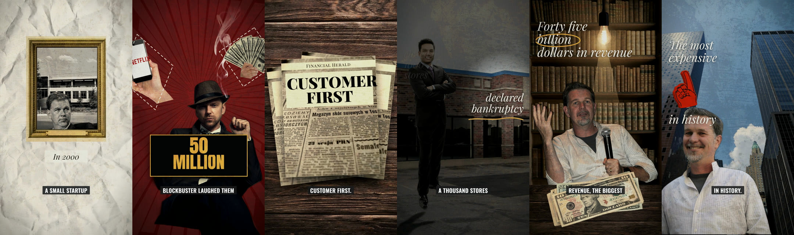
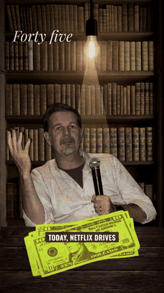
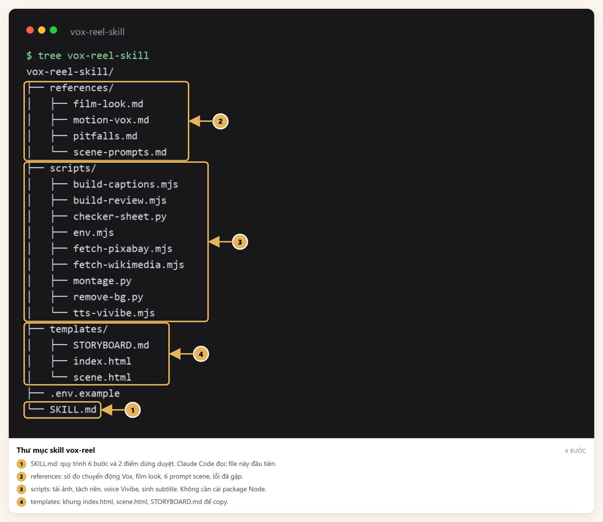
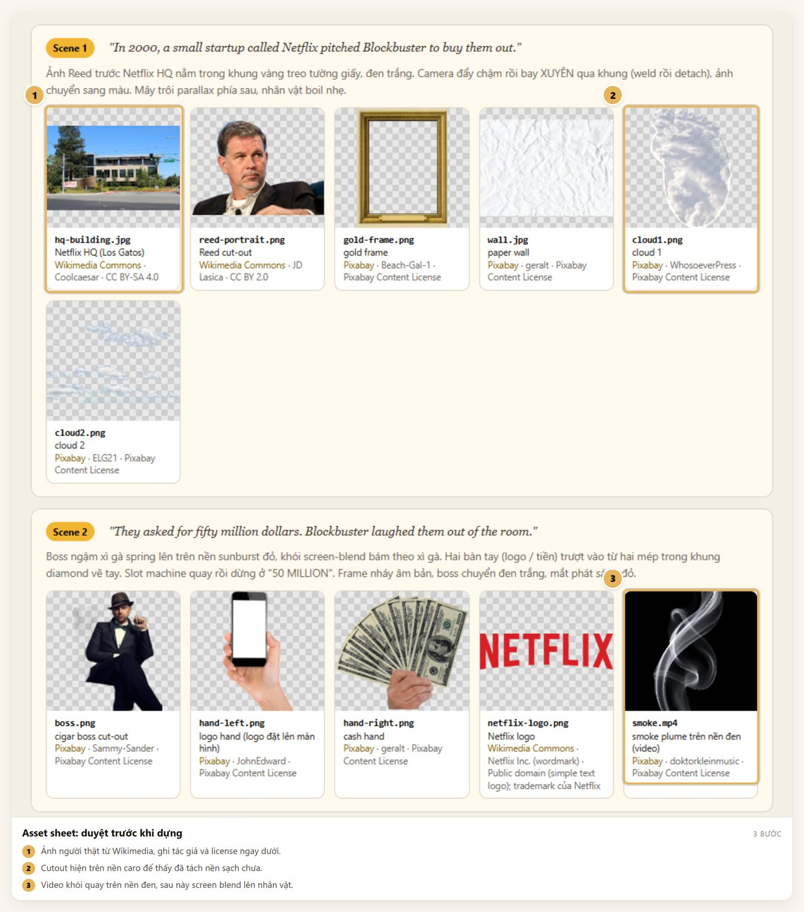
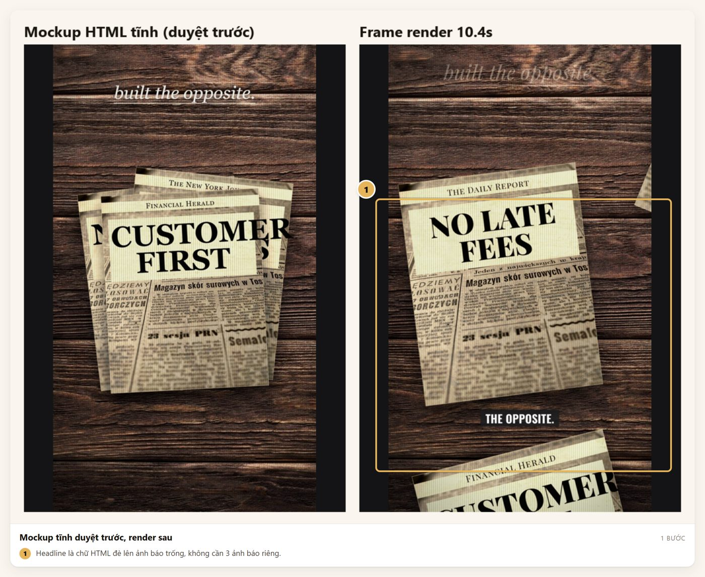
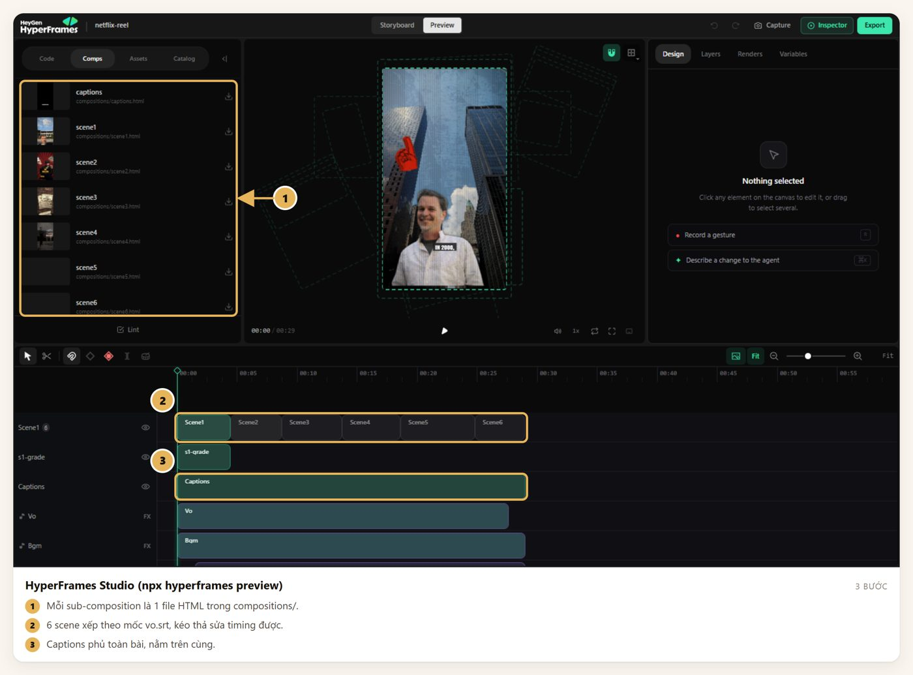
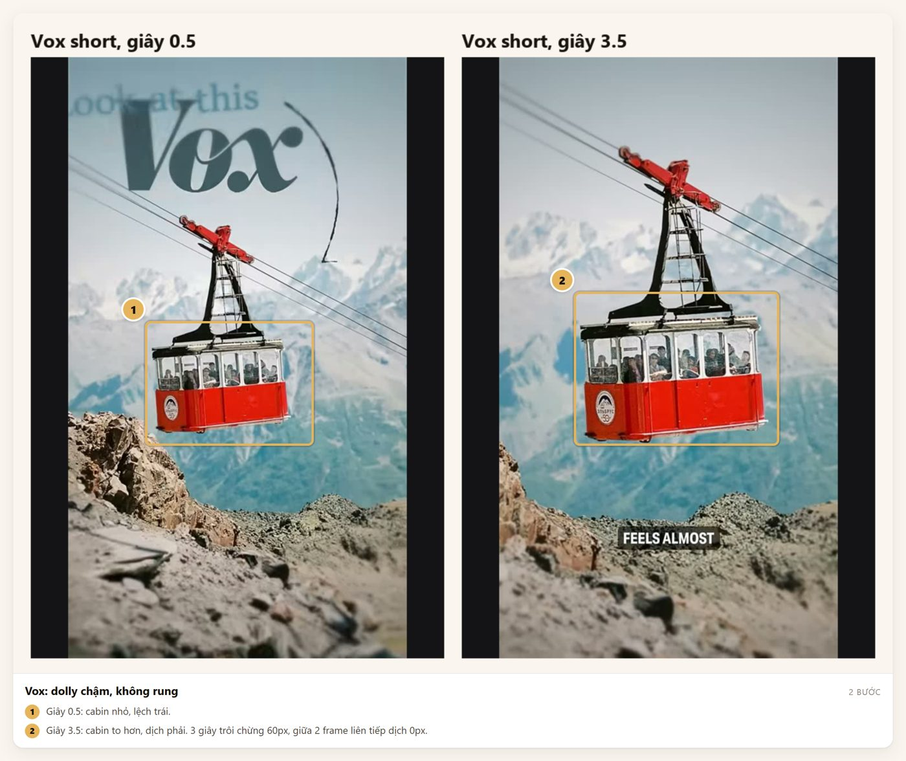

# vox-reel skill cho Claude Code

Skill giúp Claude Code dựng reel dọc 30 giây theo phong cách Vox. Ảnh thật tải từ Wikimedia và Pixabay, tách nền bằng rembg, voice AI bằng Vivibe, dựng bằng HTML + GSAP qua HyperFrames. Subtitle 2-3 từ sinh tự động từ file srt. Không dùng AI tạo ảnh.



<p>
  
  
</p>

Reel mẫu dài 29 giây, 1080x1920, 30fps, 6 scene. Quy trình dựa trên video "I Made This Viral Reel Using ONLY Remotion & Claude Code" của MoSidd, đổi Remotion thành HyperFrames và ElevenLabs thành Vivibe.

## Cần có

| Thứ | Kiểm tra |
|---|---|
| Node 22+ | `node -v` |
| Python 3 + rembg + Pillow | `pip install rembg pillow` |
| ffmpeg | `ffmpeg -version` |
| Chrome | HyperFrames render bằng Chrome |
| Key Pixabay (miễn phí) và Vivibe | điền vào `.env` |

## Cài đặt

```bash
git clone https://github.com/thanhthuduc99/vox-reel-skill ~/.claude/skills/vox-reel
cd ~/.claude/skills/vox-reel
cp .env.example .env    # điền PIXABAY_API_KEY, VIVIBE_API_KEY, VIVIBE_VOICE
```

Trên Windows, thư mục skill là `C:\Users\<bạn>\.claude\skills\vox-reel\`. Script đọc `.env` trong thư mục project trước, không có thì đọc `.env` cạnh `SKILL.md`. Đừng dán key vào chat.



## Dùng

Mở Claude Code trong một thư mục trống và gõ:

```
Dùng skill vox-reel. Làm reel 30s về <chủ đề>, voice tiếng Anh, 6 beat,
không AI generate ảnh. Dừng cho tôi duyệt sau assets và sau mockup.
```

Claude chạy 6 bước và dừng 2 lần để bạn duyệt.

1. **Script và beat sheet.** 6 dòng voiceover, mỗi dòng là 1 scene 4-6 giây.
2. **Assets thật.** Tải ảnh, tách nền, ghi nguồn và license vào `_manifest.json`. Sinh trang duyệt. **Dừng 1.**



3. **Voice.** Vivibe ra `vo.mp3` và `vo.srt`. Mốc từng dòng trong srt là mốc cắt scene.
4. **Mockup rồi dựng scene.** Mỗi scene 1 file HTML tĩnh để duyệt bố cục. **Dừng 2.** Sau đó mới viết animation.



5. **Subtitle và audio.** `build-captions.mjs` sinh subtitle từ srt, thêm nhạc nền và SFX.
6. **Check và render.** `npx hyperframes@0.8.38 check` phải pass rồi mới render.



## Chuyển động kiểu Vox

Vox không rung khung hình. Đo từ short "How Vox makes images look like videos", dịch chuyển giữa 2 frame liên tiếp bằng 0. Cảm giác sống đến từ dolly chậm và parallax. Skill áp đúng số đo đó: trôi 10-22px và zoom 1.012 lên 1.035 suốt scene, ease sine. Chi tiết trong `references/motion-vox.md`.



## Cấu trúc

| Thư mục | Nội dung |
|---|---|
| `SKILL.md` | Quy trình 6 bước, 2 điểm dừng, quy tắc bắt buộc |
| `references/` | Số đo chuyển động, film look CSS, 6 prompt scene, lỗi thường gặp |
| `scripts/` | Tải ảnh Pixabay/Wikimedia, tách nền, TTS Vivibe, sinh subtitle, trang duyệt |
| `templates/` | Khung `index.html`, `scene.html`, `STORYBOARD.md` |

## Credit ảnh trong README

Ảnh demo lấy từ reel mẫu. Ảnh Reed Hastings của JD Lasica (CC BY 2.0), Netflix HQ của Coolcaesar (CC BY-SA 4.0), đều từ Wikimedia Commons. Ảnh còn lại theo Pixabay Content License. Nhạc trong reel: "Heavy Heart" của Kevin MacLeod, CC BY 4.0.

Làm bởi [Contentta](https://github.com/thanhthuduc99).
